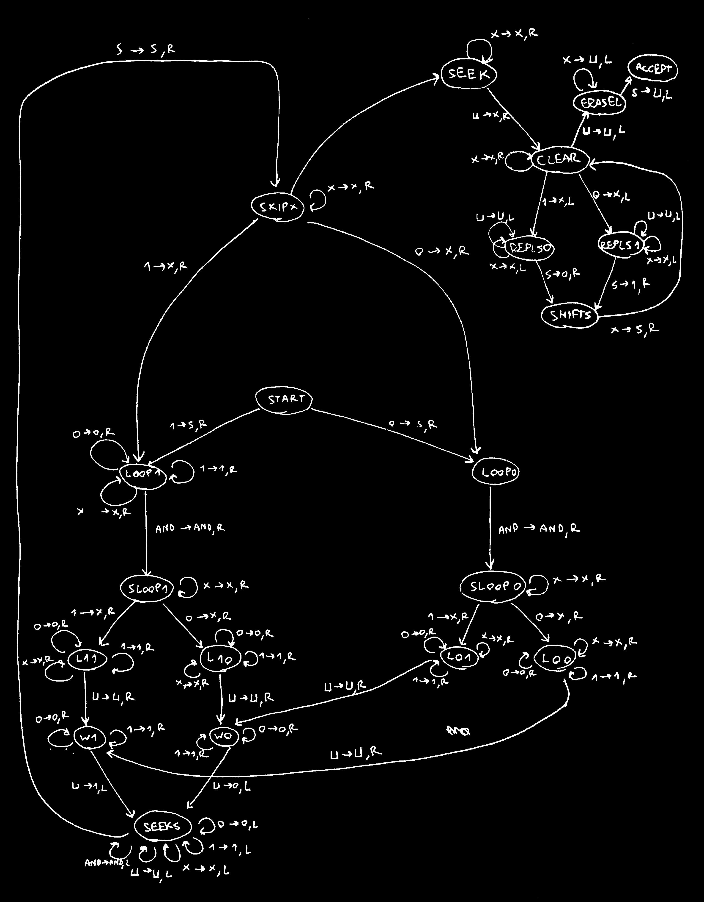

# A simple emulator of custom [Turing machines](https://en.wikipedia.org/wiki/Turing_machine)

# Usage

`python turing.py RULES_FILENAME_HERE`

# Defining the input and the transition rules

Write the input in the first line of the file (each of its symbols separated by one or more spaces) then the transition rules below.

A transition rule is formatted as

```
CURRENT_STATE CURRENT_SYMBOL > NEXT_STATE SYMBOL_TO_WRITE DIRECTION (L or R)
```

> Every undefined transition is an automatic rejection.

> The blank symbol is `_`.

> The state `START` must exist, possibly `ACCEPT` and `REJECT` too.

> Lines can be blank.

## Simple example

A TM that recognizes the 1\*0 language, tested for the input 1110.

```
1 1 1 0

START 1  >  loop x R
START 0  >  REJECT y R

loop 1   >  loop x R
loop 0   >  exit end R
loop _   >  REJECT end R

exit _   >  ACCEPT end R
```

## Bitwise AND

`bitwise_and.txt` defines the automaton below, which takes two binary numbers separated by "and", then computes their bitwise and:


